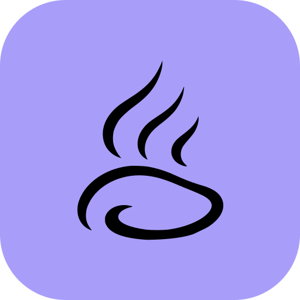

<p align="center"></p>

# Smrodek Tech Radar

[](https://github.com/CaffeinatedPinguin/tech-radar/actions/workflows/ci.yml)
[](https://github.com/CaffeinatedPinguin/tech-radar/releases/latest)
[](LICENSE)

A small, Git-backed architecture knowledge viewer for the Smrodek homelab. Technologies and
architecture decisions live as YAML; a deterministic compiler validates the source and generates the
JSON consumed by the React frontend.

The app is intentionally static: no backend, database, authentication, Markdown parser or GUI editor.
The frontend is React 19 with React Router and TypeScript, built by Vite. Zod validates the content,
and nginx serves the production image.

**Status:** active, maintained by one person on a best-effort basis. Issues are welcome; outside
pull requests are not accepted. See [CONTRIBUTING.md](CONTRIBUTING.md).

## Features

- A visual radar with four technology rings and four architecture areas.
- A searchable catalog with URL-shareable filters.
- Technology history, review metadata and linked architecture decisions.
- ADR pages with alternatives, consequences and revisit conditions.
- Schema validation for YAML content, references, dates and relationship cycles.
- A minimal nginx image for static deployment.

## Run it

```bash
docker run --rm -p 8080:8080 ghcr.io/caffeinatedpinguin/tech-radar:<version>
```

The image serves the compiled site through nginx. The health endpoint is `/healthz`.

## Releases

Stable tags use `vX.Y.Z`. A matching tag validates the version against `package.json`, runs the full
verification suite, publishes the image to GHCR and creates a GitHub Release with the commits since
the previous tag.

Images are in the [GitHub Container Registry package](https://github.com/CaffeinatedPinguin/tech-radar/pkgs/container/tech-radar),
and releases are listed on the [GitHub Releases page](https://github.com/CaffeinatedPinguin/tech-radar/releases).

## Branding

The header and favicon use `public/logo/logo.svg`. The header reads the displayed version from
`package.json`. Replace the logo or bump the package version to change those details without touching
the application shell.

## Contributing

Bug reports and feature requests go through the issue forms. Pull requests from outside contributors
are not accepted; see [CONTRIBUTING.md](CONTRIBUTING.md). Content can describe internal architecture,
so check the repository visibility and deployment target before publishing new records.

## License

Apache-2.0. See [LICENSE](LICENSE).
